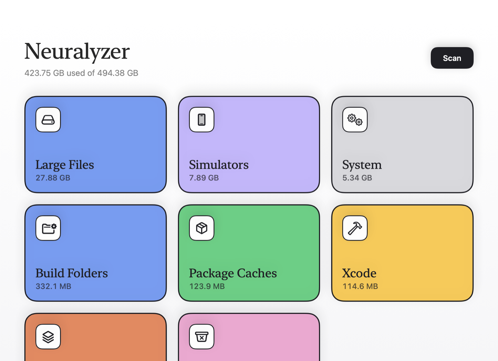

# Neuralyzer

A plain Mac app that finds what is filling your disk and cleans it. Website: [neuralyzer.shivvyas.com](https://neuralyzer.shivvyas.com). Built for a developer Mac: Xcode, simulators, Claude Code, package caches, build folders, VMs, and the big forgotten files in Downloads.

<p align="center"></p>



## What it finds

| Category | What is in it | When cleaned |
|---|---|---|
| Xcode | DerivedData, DeviceSupport, Previews, Archives | Deleted. Archives go to the Trash. |
| Simulators | Devices and runtimes, through `xcrun simctl` | Removed by `simctl` |
| Claude Code | Old session logs, shell snapshots, telemetry, Claude app caches | Deleted. Memory, settings, skills, and plugins are never touched. |
| Package Caches | npm, pnpm, Yarn, Bun, pip, Homebrew, CocoaPods, Gradle, Cargo, Go, SwiftPM, `~/.cache` | Deleted |
| Build Folders | `node_modules`, `.build`, `.next`, `DerivedData`, and `build` next to a build file, inside `~/Projects` | Deleted. `build` goes to the Trash. |
| VMs | Docker, UTM, Parallels, VMware Fusion, OrbStack, Tart, Ollama models | Trash |
| App Caches | `~/Library/Caches` and `~/Library/Logs` | Deleted |
| Junk | Crash reports, installers in Downloads | Reports deleted, installers to the Trash |
| Trash | What is already in the Trash | Deleted |
| Large Files | Anything over 500 MB in Downloads, Desktop, Documents, Movies | Trash |
| Old Files | Over 50 MB and not opened in 90 days, same folders | Trash |
| System | `/Library/Caches`, `/Library/Logs`, simulator system caches, temp files untouched for 3 days, Time Machine local snapshots, old macOS installers, iPhone backups | Asks for your password once per clean. Installers and backups go to the Trash. |

Rebuildable data is preselected. Your own files never are. Every clean is written to `~/Library/Logs/Neuralyzer/clean.log`.

## Neuralyzer for iPhone

The same cleaner for your iPhone, in `iOS/`. It cleans what iOS lets an app reach:

| Card | What is in it |
|---|---|
| Duplicates | Exact and near identical photos and videos across your library, including iCloud Photos. The best copy is kept. |
| Screenshots, Screen Recordings, Bursts, Blurry, Big Videos | What the name says |
| WhatsApp | Photos and videos WhatsApp saved to your camera roll |
| iCloud Duplicates, iCloud Large & Old | Files in the iCloud Drive folder you choose |
| Contacts | Duplicate contacts in the same account, merged, with a backup saved first |

iOS gives no app access to other apps' caches, WhatsApp's own storage, Maps data, or System Data, so Neuralyzer does not claim to clean them. The last card lists the steps only you can take for those. Photo sizes are estimates, since iOS does not share exact ones. Deleted photos stay in Recently Deleted for 30 days.

Build: `xcodegen generate`, then run the `NeuralyzerPhone` scheme. Tests: `cd iOS/NeuralyzerPhoneKit && swift test`.

## Install

Download `Neuralyzer.dmg` from [Releases](https://github.com/shivvyas2/Neuralyzer/releases), drag the app to Applications, and open it. The first launch walks you through turning on Full Disk Access, which the app needs to see caches and the Trash.

## Build

Requires Xcode 27 and [XcodeGen](https://github.com/yonaskolb/XcodeGen).

```sh
xcodegen generate
open Neuralyzer.xcodeproj
```

Tests for all scanning and cleaning logic:

```sh
cd NeuralyzerKit && swift test
```

Release (signed, notarized DMG): `scripts/release.sh`.

## How it is built

- `NeuralyzerKit` holds every rule, the safety guard, and the cleaner. It has no UI and is tested against a throwaway home folder.
- `App` holds the SwiftUI views and one store.
- No third-party dependencies, no network calls, no analytics.

## License

MIT
